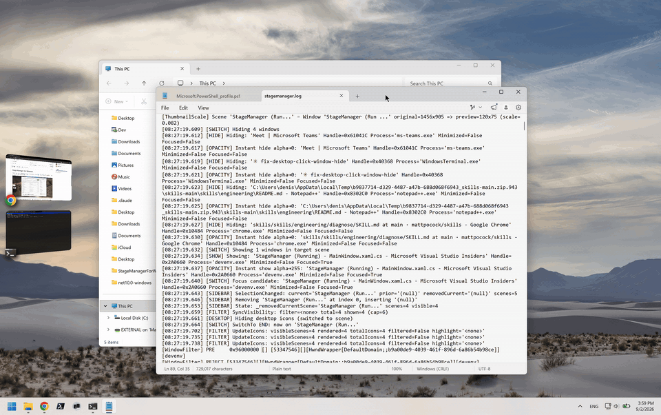

# Stage Manager for Windows

A faithful recreation of macOS [Stage Manager](https://support.apple.com/en-us/HT213315) for Windows, built on [awaescher/StageManager](https://github.com/awaescher/StageManager) and [depoledna/StageManagerForWindows](https://github.com/depoledna/StageManagerForWindows). The goal is full feature parity with macOS. Currently in beta.



Stage Manager groups your open windows by application into "scenes." One scene sits on stage while the rest wait as live, tilted previews in a sidebar strip — just like macOS. Click a preview to bring that scene on stage, or drag windows between scenes to regroup your workspace on the fly. The whole thing runs from the system tray and can be toggled on and off at any time, restoring your windows exactly as they were.

## Features

- **Scenes grouped by app** — windows are gathered per process into scenes; switching scenes parks the others off-screen. They keep running and compositing, so their previews stay live.
- **Live sidebar previews** — each tile is a real-time capture of the window, tilted and scaled to match the macOS card look.
- **Drag to regroup** — drag a window from one scene onto another to move it between groups, or onto the stage to split it out on its own.
- **Multi-monitor** — run a stage per display and choose which displays to manage. A picker appears at startup when more than one display is attached, and the layout adapts when displays or the taskbar change.
- **Global hotkey** — toggle the stage on and off from anywhere. Defaults to `Ctrl + Alt + S` and is configurable.
- **System tray menu** — turn the stage on/off, open settings, check for updates, or quit.
- **Settings that mirror macOS** — show/hide recent apps, "all at once" vs "one window at a time," click-wallpaper-to-reveal-desktop, hide desktop icons, and how many recent apps the strip shows.
- **Follows your Windows theme** — light and dark modes switch automatically with the system setting.
- **Start with Windows** — optionally launch Stage Manager at sign-in.
- **Built-in updater** — check for, download, and apply updates from the tray menu.

## Install

Download and run the executable from the [Releases tab](https://github.com/Demiguise2360/WindowsStageManager/releases) or build from source:

```bash
git clone https://github.com/Demiguise2360/WindowsStageManager.git
cd WindowsStageManager
dotnet run --project StageManager
```

To produce a standalone, single-file executable (no .NET install needed to run it):

```bash
dotnet publish StageManager/StageManager.csproj --configuration Release --runtime win-x64 --self-contained true -p:PublishSingleFile=true
```

Swap `win-x64` for `win-arm64` on ARM devices. The release pipeline builds both and attaches them to a GitHub Release whenever a `v*` tag is pushed.

### Requirements

 - Windows 10 version 2004 (build 19041) or newer
 - A GPU with Direct3D 11 support (used for live window capture)
 - [.NET 10 SDK](https://dotnet.microsoft.com/en-us/download) — to build from source

## Using Stage Manager

- **Turn it on or off** — press the hotkey (`Ctrl + Alt + S` by default) or use the tray menu. Turning it off puts every window back where it was.
- **Switch scenes** — click a preview tile in the sidebar.
- **Reveal a hidden strip** — when "show recent apps" is off, move the pointer to the screen edge to slide the strip out.
- **Handle overflow** — when there are more scenes than the strip shows, a "N more" pill lists the rest by recency.
- **Reveal the desktop** — click the wallpaper (when enabled in settings).
- **Change settings** — open **Settings…** from the tray menu; changes apply live, no restart needed.

## Settings

Settings live in the tray menu under **Settings…** and take effect immediately.

| Setting | What it does | Default |
|---|---|---|
| Show recent apps | Keep the preview strip visible, or hide it until the pointer reaches the edge | On |
| Show windows from an application | *All at once* brings every window of an app on stage together; *one at a time* brings only the window you picked | All at once |
| Click wallpaper to reveal desktop | Clicking the wallpaper sweeps all scenes aside | On |
| Number of recent apps | How many scenes the strip shows at once (1–10) | 5 |
| Hide desktop icons | Hide the desktop icons while the stage is active | On |
| Toggle shortcut | The global on/off hotkey | `Ctrl + Alt + S` |
| Start with Windows | Launch Stage Manager at sign-in | Off |
| Ask which displays at startup | Show the display picker when more than one display is attached | On |

## Roadmap

The goal is a 1:1 match with macOS Stage Manager. Key remaining work:

- **Behaviour alignment** — match macOS scene switching logic, window grouping rules, and edge cases
- **Animation polish** — window shuffle effects and remaining transition detail
- **Smarter window detection** — filter out popups and transient windows (e.g. Teams call toasts) that shouldn't create new scenes
- **Drag & drop refinement** — snap-to-scene indicators
- **Adaptive sidebar** — positioning that adapts to the layout

## Contributing

Architecture, module boundaries, and design decisions are documented in [`codemaps/`](codemaps/). Read the relevant map before changing code in that area. There is no test project — verify changes by building and running.

## Acknowledgements

Built on [awaescher/StageManager](https://github.com/awaescher/StageManager). Window tracking code from [workspacer](https://github.com/workspacer/workspacer) by [Rick Button](https://github.com/rickbutton).
